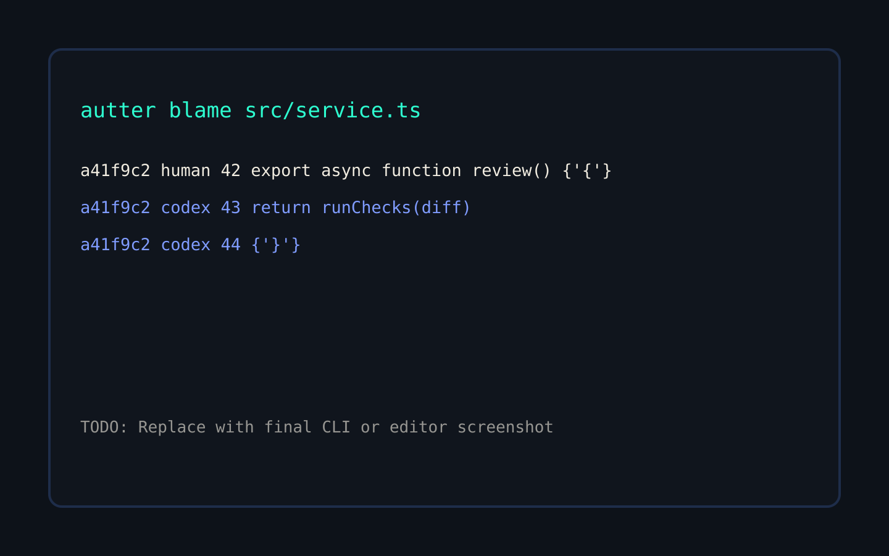

`autter blame` shows the commit author and the coding agent responsible for each attributed line.

## Inspect a file

```bash
autter blame src/services/review.ts
```

The output follows `git blame` conventions and adds AI authorship where available. Standard `git blame` flags remain available.

<Frame caption="Replace this placeholder with final terminal or editor attribution output.">
  
</Frame>

## Common examples

```bash
# Blame a file at the current revision
autter blame src/services/review.ts

# Limit output to a line range
autter blame -L 40,80 src/services/review.ts

# Inspect a previous revision
autter blame HEAD~1 -- src/services/review.ts

# Produce machine-readable output
autter blame src/services/review.ts --json
```

## From a line to the prompt that wrote it

On a terminal, `autter blame` ends with a legend of the prompts behind its AI lines:

```text
Prompts behind the AI lines:
  s_3f9a2c1d  claude  claude-opus-4-5  lines 138-140
Details: autter show-prompt s_3f9a2c1d  |  autter blame --why src/services/review.ts:138
```

Follow one line to its session, model and change:

1. `autter blame <file>` gives each prompt a short reference such as `s_3f9a2c1d`. Add `--show-prompt` to print the reference on every AI line; the legend is then printed even when output is piped.
2. `autter blame --why <file>:<line>` explains one line: agent, model, prompt reference, the agent's own session ID, the commit, and the prompt transcript.
3. `autter show-prompt <reference>` prints the full prompt record as JSON, including the commit whose authorship note holds it.
4. `git show <commit>` shows the change itself.

`autter show-prompt` accepts:

| ID | Example |
| --- | --- |
| Short reference from `blame` (any unique prefix of 4+ hex characters) | `s_3f9a2c1d` |
| Full session ID | `s_3f9a2c1d4e5f60` |
| A line's attestation key | `s_3f9a2c1d4e5f60::t_0a1b2c3d4e5f60` |
| Prompt hash from older notes | `0123456789abcdef` |
| The agent's own session ID | a Claude Code session ID |

Run `autter show-prompt --help` for the same list.

Transcripts are read from your machine first, then from Autter when you are connected and signed in. Secrets are redacted before a transcript is stored. When a transcript can't be shown, `--why` and `show-prompt` (in `transcript.reason`) say why: no transcript was recorded, it stayed on the machine that made the commit (local mode), or you need to run `autter login`. Authorship notes made on other machines arrive with `autter fetch-notes`.

## Use blame during review

AI blame helps you answer:

- Which agent session introduced this line?
- Did a human edit the generated code before commit?
- Which model produced the surrounding implementation?
- Is the same session responsible for related lines in other files?

Use prompt access according to your organization's permissions. Prompt content may be local-only, connected but restricted, or unavailable.

## Editor support

The Autter VS Code extension can display color-coded AI attribution in the gutter for VS Code and compatible editors such as Cursor, Windsurf, and Antigravity.

<Card title="Install the VS Code extension" icon="arrow-up-right-from-square" href="https://marketplace.visualstudio.com/items?itemName=autter.autter-vscode">
  View AI attribution beside the code you are reviewing.
</Card>

## JSON for tools

Use `--json` when building an editor, review tool, or internal analysis pipeline. Treat prompt and identity fields as sensitive data.

<Card title="Data and privacy" icon="shield" href="/cli/data-and-privacy">
  Understand where attribution identities and prompt records are stored.
</Card>
