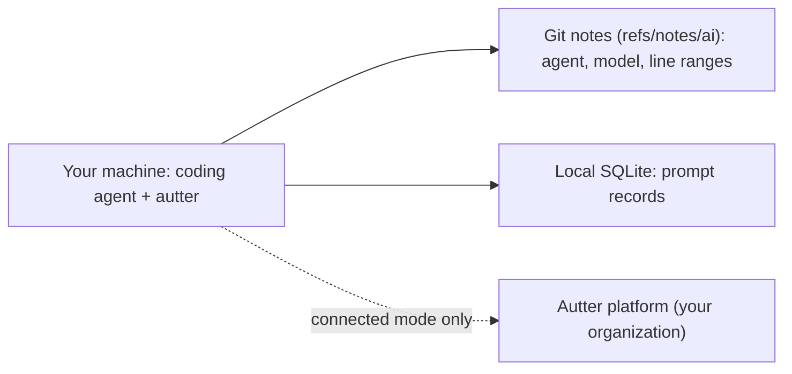

You choose whether the Autter CLI stays local or connects to the Autter platform. You can change this choice at any time.



## Storage at a glance

| Data | Local-only | Connected personal dashboard | Teams or Enterprise |
| --- | --- | --- | --- |
| Prompt records | Local SQLite | Uploaded unless `prompt_storage` is `local` | Team prompt store, with best-effort secret and PII redaction |
| Line-level attribution | Local Git notes | Local Git notes, uploaded to your organization in connected mode {/* TODO: align with CLI data-privacy.md, which does not list note upload. */} | Local Git notes plus team and SCM-linked processing where enabled |
| Agent and model identifiers | Git notes | Git notes and connected transcript or usage records | Git notes and team analytics |
| Git name and email | Git notes | Used with connected attribution | Stored as employee identity and SCM membership |
| Tool calls, MCP calls, skills, errors, interruptions, tokens | Not uploaded as cloud analytics | Uploaded for personal analytics | Uploaded for team analytics |
| SCM profile and pull request metadata | Not uploaded by local-only CLI | SCM profile metadata | PR description, opener, reviewer, status, and related metadata |
| Pull request diffs | Not uploaded by local-only CLI | Depends on connected product workflow | Processed to compute AI percentage; not stored |
| Anonymous error and usage telemetry | Off until you opt in | Off until you opt in | Off until you opt in; can be redirected |

<Note>
  Autter's public CLI privacy document does not state a universal cloud retention period. Check your agreement, deployment policy, or the [Autter Trust Center](https://trust.autter.dev) for current terms.
</Note>

## Local-only mode

Without login, Autter says it does not send code, prompts, or agent-usage data to the Autter platform.

Local-only storage includes:

- Prompt records in local SQLite storage
- Temporary checkpoints under `.git/ai`
- Attribution in Git notes, including the agent, model, line ranges, acceptance metrics, and steering developer's Git name and email

Git notes are part of the repository's Git data. Anyone who receives the notes and has repository access can read their metadata.

Anonymous error and usage telemetry is off until you opt in, during `autter onboard` or with `autter telemetry on`. It never includes code or prompts. To check or change it:

```bash
autter telemetry status   # on or off, and where events go
autter telemetry log      # the local audit log of every event sent
autter telemetry off      # stop sending
```

See [`autter telemetry`](/cli/more-commands#autter-telemetry).

## Connected personal dashboards

When you opt in to a personal dashboard, Autter Cloud receives:

- Agent activity such as tool calls, MCP calls, skills, interruptions, errors, and token usage
- Prompts and agent responses used for personal analytics
- AI percentage, parallel-agent counts, and related dashboard metrics
- SCM profile metadata from GitHub, GitLab, or Bitbucket

Personal agent-usage data is visible only to you unless you share it.

### Transcript upload path

When a commit has a captured agent transcript, Autter:

1. Reads and normalizes the local JSON or JSONL transcript.
2. Removes detected secrets before the transcript leaves the machine.
3. Queues the transcript in local durable storage as a content-addressed object.
4. Adds a `cas:<hash>` reference to the prompt record in the authorship note.
5. Lets the background service upload queued content to the connected organization environment.

This process is best-effort. Missing, empty, or invalid transcripts are skipped, and transcript failures do not block commits.

## Teams and Enterprise

Team deployments can also store:

- Employee names, email addresses, and SCM team membership
- Full prompt records with best-effort secret and personal-data stripping
- Full agent sessions for review and summarization
- Pull request metadata from supported SCMs
- Organization-wide attribution, token, cost, and agent-usage analytics

Prompt records are write-only for developers unless an administrator grants read access. Self-hosted deployments send this data to the team's own Autter instance.

## Opt out of cloud storage

To clear credentials and reselect local-only mode:

```bash
autter logout
autter onboard --local --force
```

This stops future connected writes from that machine. It does not automatically delete data uploaded before you opted out.

{/* TODO: Add the approved cloud-data deletion workflow and support contact once Autter publishes it. */}

<Warning>
  Switching to local-only mode does not delete existing organization data. Use your organization's deletion process or contact Autter support for a deletion request.
</Warning>

## Stay connected but keep prompts local

You can stay signed in to the platform while stopping uploads from your machine:

```bash
autter config set prompt_storage local
```

This stops every connected upload from that machine, not only prompts. Authorship notes, transcripts, and usage data stay on your computer, and `autter whoami` shows "Cloud upload: off". Runtime then cannot show who wrote the code behind an error for your commits.

{/* TODO: confirm whether exclude_prompts_in_repositories keeps notes uploading and recommend it here if so. */}

Use `prompt_storage local` only when you want to stop connected storage as a whole. To stop it for one repository, see [Disable Autter for a repository](#disable-autter-for-a-repository).

## Disable Autter for a repository

From the repository, run:

```bash
autter config --add exclude_repositories .
```

This adds the repository's remote to your machine-level exclusion list.

## Protect sensitive data

- Never place credentials or secrets in agent prompts.
- Exclude repositories that cannot upload any data. See [Disable Autter for a repository](#disable-autter-for-a-repository). Setting `prompt_storage` to `local` stops every upload from your machine, including authorship notes.
- Review Git-note access because attribution includes developer identity.
- Store CI access tokens in a secret manager.
- Review organization permissions before enabling prompt access for developers.

For published policy details, see the [Autter privacy policy](https://autter.dev/privacy-policy) and [Trust Center](https://trust.autter.dev).
