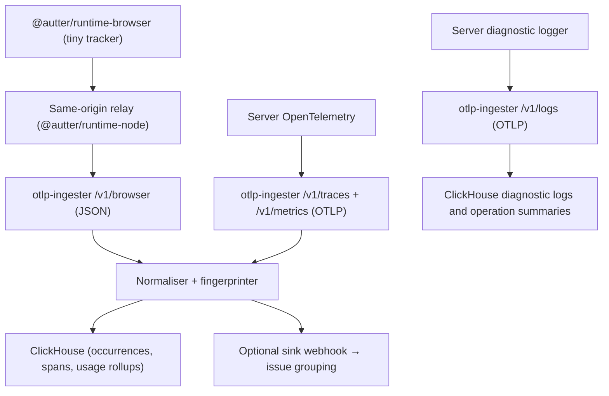

Autter Runtime tracks **runtime errors and usage** from your frontend and backend. Compatible server releases also collect structured diagnostic logs and operation outcomes. It deliberately does not ship the full OpenTelemetry browser SDK to your users:

- the browser gets a dependency-free error and usage tracker of **about 5 KB** (brotli)
- your server keeps real OpenTelemetry
- Autter Runtime's **OTLP ingester** receives both and writes them to ClickHouse in a compact, per-repository data model

**Set it up by hand in five steps:** create a server key, `npm install @autter/runtime-node`, add a few lines of `initAutterServer`, run `npx @autter/runtime-node verify`, and look in the app. The hosted ingester needs no Docker or database.

<CardGroup cols={2}>
  <Card title="Quickstart" icon="rocket" href="/runtime/quickstart">
    Send your first event by hand in five steps, with the output to expect.
  </Card>
  <Card title="Installation" icon="download" href="/runtime/installation">
    Install the package for your stack — browser, Node, Next.js or edge.
  </Card>
</CardGroup>

## How it fits together



<Tip>
  Prefer to have a coding agent set it up?

  ```bash
  npx skills add Autter-dev/autter-skills --all
  ```

  Then tell your agent: *"use the skills to install Autter Runtime in this
  project."* See [AI agent skills](/runtime/skills) for details.
</Tip>


## Investigate customer operations

Record measured steps, nested context and explicit outcomes for checkout
requests, queue jobs or scheduled work. Runtime's **Logs** view displays those
records; issue **Operation evidence** links captured IDs to logs and spans for
root-cause analysis and eligible draft fixes. A failed payment after retries
can be reported even when the callback returns normally.

Diagnostic logs remain separate from issues and delivery is best effort.
The APIs need a published release containing them and matching ingestion and
platform deployments. See [Operation logging](/runtime/operation-logging) for
capability checks, setup and verification.

## Find endpoint regressions

Autter can detect slower HTTP endpoints from request-duration histograms, compare normal and slow traces, collect team feedback, and generate draft fix pull requests when evidence supports a change. Your team reviews, merges, and deploys fixes. Automatic rollback is not part of this pipeline.

Your service must send compatible metrics and retain useful traces. Platform access does not update your SDK settings. See [Endpoint regressions](/runtime/endpoint-regressions) for setup and data requirements.

## Packages

| Package | Description |
| --- | --- |
| [`@autter/runtime-browser`](https://github.com/Autter-dev/autter-runtime/tree/main/packages/runtime-browser) | Zero-dependency browser error + usage tracker, about 5 KB (brotli); breadcrumbs, tracing and filters are opt-in add-ons of under 1 KB each |
| [`@autter/runtime-node`](https://github.com/Autter-dev/autter-runtime/tree/main/packages/runtime-node) | Same-origin relay + OpenTelemetry server tracker; compatible releases add logs and operations |
| [`@autter/runtime-next`](https://github.com/Autter-dev/autter-runtime/tree/main/packages/runtime-next) | One-command Next.js integration (relay route + error boundary) |
| [`@autter/runtime-edge`](https://github.com/Autter-dev/autter-runtime/tree/main/packages/runtime-edge) | Cloudflare Workers, Vercel Edge, Deno and Bun: request events and coded errors over `fetch`, zero dependencies |
| [`@autter/runtime-cli`](https://github.com/Autter-dev/autter-runtime/tree/main/packages/runtime-cli) | Source map upload: the `autter-runtime` CLI plus Vite/Rollup, webpack and Next.js plugins. See [Source maps](/runtime/source-maps) |
| [`@autter/otlp-ingester`](https://github.com/Autter-dev/autter-runtime/tree/main/packages/otlp-ingester) | Self-hostable ingest service — OTLP/HTTP traces, metrics and logs, plus browser payloads, into ClickHouse |

`@autter/runtime-core` is internal. It is bundled into `@autter/runtime-node` and `@autter/runtime-edge` and is not published, so do not install it. You may see its name in stack traces and the changelog.

Python services use [`autter_tracing.py`](/runtime/integrations#python-django-fastapi-flask-celery), an adapter file you copy into your project rather than a package.

A runnable demo lives at [`examples/express-app`](https://github.com/Autter-dev/autter-runtime/tree/main/examples/express-app) — browser tracker → relay → ingester, and the OpenTelemetry server tracker, against a Docker Compose ClickHouse.

## Supported stacks

| Stack | How | Key type |
| --- | --- | --- |
| React / any SPA / static site | `@autter/runtime-browser` (direct) | client key (publishable) |
| React/SPA with a backend | `@autter/runtime-browser` → relay | none in browser; server key in relay |
| Next.js | `@autter/runtime-next` | server key |
| Node (Express, Fastify, Koa, Nest) | `@autter/runtime-node` | server key |
| Cloudflare Workers, Vercel Edge, Deno, Bun | `@autter/runtime-edge` | server key (stored as a secret) |
| Go, Rust, Python, Java, .NET, … | any OpenTelemetry SDK → OTLP/HTTP (protobuf or JSON) | server key |

Errors group the same way for every stack: the ingester parses each language's native stack format, so the same defect stays one issue across re-deploys and unrelated errors that share a message stay separate. See [Architecture & data model](/runtime/architecture#fingerprinting) for how grouping works.

See [Stack integrations](/runtime/integrations) for per-stack snippets, or [Using Autter Runtime without npm](/runtime/without-npm) if your service has no `@autter/*` package at all.

## Keys and command-line tools

Autter has two command-line tools and four kinds of key. Each key does one job; using the wrong one is the most common setup mistake.

| Prefix | Name | Create it in | Where it goes | What it can do | If you use it in the wrong place |
| --- | --- | --- | --- | --- | --- |
| `autter_rt_` | Runtime server key | **Settings → Keys and tokens → Set up a key**, choose **Send errors from my backend service**, and pick the repository | Backend environment variables (`AUTTER_RUNTIME_KEY`), relays, edge secrets | **Secret.** Send OTLP traces, metrics and logs, and browser events | In a browser bundle it leaks; rotate it |
| `autter_rtc_` | Runtime client key | **Settings → Keys and tokens → Set up a key**, choose **Catch errors in my frontend**, as a client key with allowed origins | Frontend code, for direct browser capture only | **Publishable.** Send browser events (`/v1/browser`) from allowed origins | On a server it is refused for OTLP |
| `autter_rtu_` | Source map upload key | The repository's **Runtime** settings → **Source map upload key** | The CI or build step that uploads source maps | Upload and check source maps, nothing else | As an ingest key it is refused ([Delivery](/runtime/delivery)) |
| `autter_pat_` | Personal access token | **Org Settings → Access Tokens** | `autter login --token` when browser sign-in cannot complete; MCP clients | Act as you in the Autter platform from the Autter CLI or MCP | Not a Runtime key: ingest refuses it |

| Tool | What it is | Install | What it does | Signs in with |
| --- | --- | --- | --- | --- |
| `autter` | The Autter CLI, written in Rust | [`install.sh` or `@autter/cli`](/cli/install) | AI authorship (`blame`, `stats`), `ask`, `logs`, `lineage`, repository memory | `autter login` (browser) or a personal access token |
| `autter-runtime` | The Runtime command, an npm bin | Ships with `@autter/runtime-node` and `@autter/runtime-cli`; run it with `npx` | `doctor`, `verify` (`npx @autter/runtime-node …`), `sourcemaps upload` (`@autter/runtime-cli`) | A Runtime key in `AUTTER_RUNTIME_KEY` |

You do not need the Autter CLI to use Runtime, and the Runtime command never uses your personal access token.

<Tip>
  When your app has a backend, prefer the **relay**: the browser posts to your own server, which forwards with the server key. No key ever reaches the browser, and ad-blockers can't tell it apart from your own API traffic.
</Tip>

## Design principles

- **Errors are 100%; ordinary successful traces are sampled.** Raw error occurrences are always kept (14-day TTL); successful traces are normally sampled upstream (0.5–1%); usage is stored as 1-minute rollups (90 days). Explicit Node operation spans are always recorded; diagnostic logs use a separate bounded exporter.
- **Per-repository analysis.** Every row is keyed by `org_id` + `repository_id`.
- **Privacy by construction.** No cookies, no DOM, no request/response bodies, no emails, no full URLs with query strings.
- **OTLP-compatible at the ingestion layer**, not inside a small browser script.

Autter Runtime is open source under the MIT license: [Autter-dev/autter-runtime](https://github.com/Autter-dev/autter-runtime).
